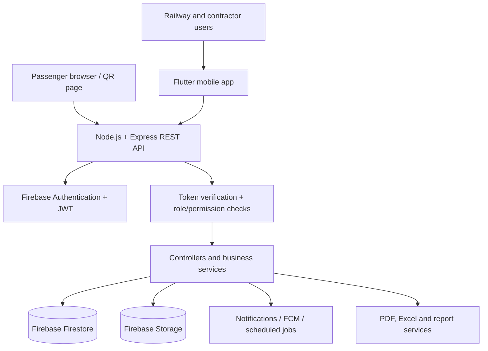
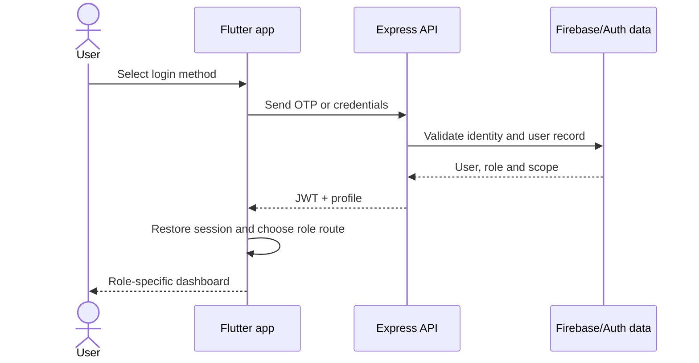
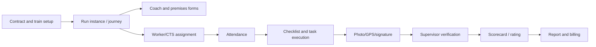

# Swachh Railways: Complete Application Architecture and User Guide

**Audience:** passengers, railway teams, contractors, supervisors, inspectors, workers,
administrators, testers, and implementation/support teams  
**Purpose:** explain what the system does, who can use each part, how information moves
through the system, and how the major business processes are completed.

> This document describes the current application as implemented in this repository.
> The backend permission names in `backend/src/permissions/roles.js` are the technical
> source of truth. Some older mobile screens use friendly role labels such as
> “Contractor Master” while the API uses `CONTRACTOR_MASTER`.

---

## 1. What the application is

Swachh Railways is a railway cleaning and housekeeping operations platform. It connects
the complete chain:

```text
Railway / company setup
        ↓
Stations, platforms, areas, trains, contracts and workers
        ↓
Schedules, frequencies, shifts and task assignments
        ↓
Worker attendance and field execution
        ↓
Photos, GPS, signatures and other evidence
        ↓
Supervisor inspection, scoring and approval
        ↓
Complaints, feedback, reports, analytics and billing
```

The application supports two operational environments:

1. **On-board housekeeping (OBHS/MCC):** cleaning and service work performed on
   trains, coaches, depots, washing plants and related premises.
2. **Station cleaning:** cleaning work performed at stations, platforms and configured
   station areas.

Passengers have a limited public journey for feedback and service requests. They do not
need access to internal railway, contractor, billing, or worker operations.

---

## 2. High-level system architecture



### 2.1 Client layer

The client is a Flutter application in [`app/`](./app/). It provides:

- login, OTP, password and session restoration;
- role-based navigation;
- dashboards and operational forms;
- worker task and attendance flows;
- camera/photo, GPS and signature capture;
- filters, lists, detail views and approval screens;
- local draft storage for selected offline or interrupted forms;
- report viewing, sharing and export actions.

The app does not decide whether an operation is truly authorized. It hides or shows
features for usability, but the backend must authorize every protected request.

### 2.2 API layer

The backend is a Node.js/Express application in [`backend/`](./backend/). Its normal
request path is:

```text
HTTP request
  → CORS, Helmet, compression, body parsing
  → request logging and metrics
  → JWT verification
  → permission and scope checks
  → route
  → controller
  → service/business rules
  → Firestore/Storage
  → JSON response
```

The route registration and public health endpoints are in
[`backend/src/app.js`](./backend/src/app.js). API documentation is exposed at
`/api-docs` when the server is running.

### 2.3 Data and file layer

- **Firebase Authentication:** identity, login and account lifecycle.
- **JWT:** API session token containing the authenticated identity and role.
- **Firestore:** operational documents, master data, status transitions and audit
  records.
- **Firebase Storage:** photos, signatures, evidence and generated files.
- **Scheduled jobs:** notifications, auto-processing, overdue checks and other
  recurring operations in `backend/src/cron.js`.

The database wrapper in [`backend/src/database/index.js`](./backend/src/database/index.js)
centralizes Firestore and Storage access. Existing Firestore documents are intentionally
treated as backward-compatible data; a new optional field should not make old documents
unusable.

---

## 3. Identity, login and session flow



Supported onboarding and account actions include:

- mobile OTP login;
- mobile/password login;
- email/password login;
- email OTP login;
- forgot-password verification and reset;
- remember-me/session restoration;
- profile update and password change;
- account status and permission checks;
- logout when a token expires or is rejected.

The backend enriches the authenticated request with fields such as zone, division,
depot, station, platform, area, entity, contract, worker type and assigned stations.
These fields determine not only *what* a user can do, but also *which records* the
user should see.

### User-facing rule

If a menu or button is missing, this normally means one of three things:

1. the role does not have the required permission;
2. the user is outside the station/platform/area/contract scope;
3. the feature is available only in another operational route, such as OBHS or
   station cleaning.

---

## 4. Roles and responsibilities

The backend defines these roles in
[`backend/src/permissions/roles.js`](./backend/src/permissions/roles.js). Role hierarchy
is an ordering aid; it is not a replacement for a specific permission.

### 4.1 Platform and governance roles

| Role | Plain-language responsibility | Typical capabilities |
|---|---|---|
| `SUPER_ADMIN` | Owns the whole platform | All available permissions; system recovery and configuration |
| `COMPANY_MASTER` | Top-level company/contractor operator | Users, entities, contracts, trains, assignments, reports, billing and system-wide contractor operations |
| `RAILWAY_MASTER` | Railway-wide oversight | Cross-railway visibility, reports, analytics, approvals and shift-summary review |
| `ADMIN` | General administrative operator | Administrative setup, user and master-data management, schedules, tasks and inspections |
| `RAILWAY_ADMIN` | Railway administrative manager | Railway master data, user management, stations, contracts, tasks, billing and operational approvals |

### 4.2 Field supervision roles

| Role | Plain-language responsibility | Typical capabilities |
|---|---|---|
| `RAILWAY_INSPECTOR` | Verifies cleaning quality | Inspections, scores, evidence review, complaints and station/area observations |
| `RAILWAY_SUPERVISOR` | Manages execution in an assigned railway scope | Worker deployment, shifts, tasks, attendance, daily logs, reviews and escalations |
| `STATION_MASTER` | Owns one station's operation | Station dashboard, areas, platforms, schedules, workers, station tasks, complaints and reports |
| `AREA_MASTER` | Owns one or more configured station areas | Area configuration, area assignment, area performance and task oversight |
| `PLATFORM_MASTER` | Owns a platform or platform group | Platform configuration, platform workers, platform tasks and local performance |

`STATION_MASTER`, `AREA_MASTER` and `PLATFORM_MASTER` are supported by the station
cleaning UI and may be represented by legacy or friendly labels in older client screens.
The backend authorization should be checked when a deployment uses one of these scopes.

### 4.3 Contractor and OBHS roles

| Role | Plain-language responsibility | Typical capabilities |
|---|---|---|
| `CONTRACTOR_MASTER` | Contractor/company head | Contractor dashboard, contracts, workers, trains, reports and compliance |
| `CONTRACTOR_ADMIN` | Contractor operations administrator | Assign workers, manage operational records, monitor tasks and contractor data |
| `CONTRACTOR_SUPERVISOR` | Contractor field supervisor | Assign/monitor field work, attendance, coach/premises forms and review submissions |
| `CTS` | Coach/Train Service operator | View train/coach work, complete CTS forms, record attendance and submit evidence |

The OBHS/MCC journey also uses the following worker-level identities:

| Role | Plain-language responsibility | Typical capabilities |
|---|---|---|
| `WORKER` | General assigned cleaning worker | Assigned tasks, attendance, evidence, complaints and personal ratings |
| `RAILWAY_WORKER` | Railway-employed field worker | Station tasks, attendance, evidence, complaints and personal work history |
| `JANITOR` | On-board or station cleaning worker | Cleaning checklist, assigned tasks, attendance and evidence |
| `ATTENDANT` | On-board service/linen attendant | Attendant/linen tasks, attendance, checklist and evidence |

### 4.4 Public role

| Role | Plain-language responsibility | Typical capabilities |
|---|---|---|
| `PASSENGER` | Passenger using public services | Submit feedback or a service request; view the passenger-facing response/status where enabled |

Passengers should never be given internal worker, contract, billing, audit or user
management permissions.

---

## 5. How permissions work

The platform uses permission-based access rather than relying only on screen names.
Representative permission families are:

- **Users:** create, update, approve, reject, suspend, delete, view.
- **Entities and contracts:** register, approve, suspend, view and maintain contracts.
- **Railway structure:** stations, platforms, areas, zones, divisions and schedules.
- **Trains and runs:** create/update trains, create or activate run instances, complete
  journeys and view run history.
- **Forms and quality:** submit coach forms, score, approve, reject, acknowledge and
  lock forms.
- **Tasks:** submit, view, start, complete, resubmit, approve and reject.
- **Workforce:** manage workers, area assignments, deployments and shifts.
- **Evidence and oversight:** inspections, scorecards, audit logs, reports and analytics.
- **Resources:** machines, materials, garbage, pest control and activities.
- **Customer service:** complaints, passenger requests and feedback.
- **Finance:** generate, view, configure, approve billing and record payments.

The backend applies checks in layers:

```text
Valid token?
  ↓
User still exists?
  ↓
Required permission?
  ↓
Allowed entity/contract/zone/division/depot?
  ↓
Allowed station/platform/area?
  ↓
Allowed status transition?
  ↓
Perform operation
```

An “administrator” therefore does not automatically see every record. The data scope
attached to the account still matters.

---

## 6. Application entry paths

After login, the Flutter app routes users to one of three main experiences.

### 6.1 Common railway navigation

Used by railway managers, administrators, inspectors, supervisors, station/platform
masters and selected contractor management roles.

Typical tabs and destinations:

1. dashboard and KPIs;
2. forms and scorecards;
3. stations, areas and platforms;
4. trains and run instances;
5. users, entities and contracts;
6. reports, alerts, billing, audit and settings.

### 6.2 Worker navigation

Used by `WORKER`, `RAILWAY_WORKER`, `JANITOR` and `ATTENDANT` when they are not
being routed through the OBHS-specific screens.

The five primary worker areas are:

1. **Home:** today's summary, quick actions and notifications.
2. **Tasks:** assigned work, execution, evidence and submission.
3. **Attendance:** check-in, check-out, history and exceptions.
4. **Complaints:** create and track work-related complaints.
5. **Ratings:** personal quality feedback and rating history.

### 6.3 OBHS/MCC navigation

Used by contractor and on-board housekeeping roles. It separates responsibilities:

- contractor master dashboard and contracts;
- contractor admin assignment management;
- contractor supervisor field execution;
- CTS train/coach view and CTS forms;
- janitor home and coach checklist;
- attendant home and linen/service tasks;
- OBHS attendance, report summary and approval;
- run management, depot/washing runs and MCC operations.

The exact visible menu is role-specific. A worker should focus on the task board and
evidence; a supervisor should focus on assignments and review; a master should focus
on contracts, workforce, compliance and reports.

---

## 7. Functional architecture by module

### 7.1 Dashboard and analytics

Dashboards aggregate operational data into:

- open and completed tasks;
- attendance and exceptions;
- cleaning scores and inspection results;
- complaint and feedback status;
- workforce deployment;
- station, platform, area or train performance;
- billing and penalty-risk indicators;
- trend charts and filtered KPIs.

Dashboard filters commonly include zone, division, depot, station, platform, area,
contract, date and status. A user sees only filters allowed by their scope.

### 7.2 Railway structure and master data

The master-data foundation is hierarchical:

```text
Railway/company
  → zone
    → division
      → depot / station
        → platform
          → area / zone
            → work item / task
```

Users should create or configure the hierarchy before generating operational tasks.
The main records are:

- stations;
- platforms;
- areas and area configuration;
- trains, coaches and run instances;
- divisions, zones and depots;
- activities and task types;
- machines and materials;
- geofences and schedules.

### 7.3 Entity, contractor and contract management

This module establishes *who is responsible* for work:

1. register or update an entity/company;
2. approve the entity;
3. create a contract and define its period/scope;
4. configure rates, frequencies and service obligations;
5. attach stations, trains, platforms or areas;
6. create contractor users and assign scope;
7. monitor compliance and billing.

Suspended or expired entities/contracts should not be used for new assignments.
Existing historical records remain available for audit and reporting.

### 7.4 User and workforce management

The user-management flow is:

```text
Create user → choose role → assign scope → approve → activate → monitor
```

The scope may contain entity, contract, zone, division, depot, station, platform,
area, worker type and assigned stations. Managers can update or suspend users when
the appropriate permission is present.

Workforce operations then connect a person to the work:

```text
Worker → shift/deployment → station/platform/area → task → evidence → review
```

### 7.5 Frequency, schedule and task generation

Recurring work does not need to be entered manually every time:

```text
Configure service frequency
  → calculate time slots
  → generate tasks
  → assign workforce/area
  → notify assignees
```

Managers should confirm the station, area, platform, date, frequency and worker scope
before approving generated tasks. Emergency tasks can be created separately when a
normal schedule is not sufficient.

### 7.6 Task execution

The standard task lifecycle is:

```text
CREATE
  → ASSIGN
  → NOTIFY
  → START
  → EXECUTE
  → CAPTURE EVIDENCE
  → SUBMIT
  → REVIEW
  → APPROVE or REJECT
  → COMPLETE or RESUBMIT
```

Depending on task type, evidence can include:

- before/after photographs;
- GPS position;
- timestamp;
- worker signature;
- quantity, weight or checklist values;
- supervisor notes;
- machine/material usage.

Rejected work should be corrected and resubmitted rather than silently edited after
approval. Approved/locked records are used by reports and billing.

### 7.7 Attendance and deployment

Attendance proves that a worker was available for the assigned shift and location:

```text
MARK_IN → optional MID_MARK → MARK_OUT → exception detection → review/approval
```

The app may use time, GPS, photo and station/geofence information. Supervisors review
missing, late, duplicate or out-of-scope attendance. Deployment and shift records
explain *where* and *when* the worker was expected to work.

### 7.8 Cleaning forms, inspections and scorecards

Forms capture structured work quality for coaches, premises, CTS operations and station
cleaning:

```text
Create/draft → fill checklist → attach evidence → submit
  → inspect/score → approve or reject → lock → report
```

Scorecards may use weighted criteria. A score is not the same as approval: a supervisor
or authorized inspector must complete the review action.

### 7.9 Complaints, passenger feedback and service requests

#### Internal or worker complaint lifecycle

```text
CREATE → ASSIGN → TRACK → RESOLVE → CLOSE
```

Users should include category, priority, location, description and photos where
available. Supervisors assign responsibility and record resolution evidence.

#### Passenger flow

```text
Passenger scans QR/open portal
  → selects feedback or service request
  → provides train/station/request details
  → submits
  → operations team receives and manages it
  → resolution/status is recorded
```

Passenger submission is intentionally simpler than an authenticated employee workflow.
Do not ask a passenger to create an internal worker account merely to report a problem.

### 7.10 Machines, materials, garbage and pest control

These modules support the resources needed to execute cleaning:

- machine master data, assignment, deployment, return and maintenance;
- material stock, issue, return, reorder threshold and approval;
- garbage type/weight, location, photo and disposal record;
- pest type, location, treatment, evidence and review.

Resource records should be linked to the station, area, task or shift whenever the
screen provides that field. This makes consumption and performance auditable.

### 7.11 Reports, audit and alerts

Reports combine operational records into daily, weekly, monthly or contract-level
outputs. Depending on permission, users can view, generate, export, schedule or share
reports in PDF/Excel formats.

Audit logs record important changes, including who performed an action, what object was
affected, and when. Alerts notify users about assignments, approvals, exceptions,
overdue tasks, stock thresholds and other operational events.

### 7.12 Billing and performance billing

Billing uses approved operational evidence, contracts, rates and configured service
rules. A simplified flow is:

```text
Contract/rate configuration
  → approved tasks/forms/shift summaries
  → quantity and performance calculation
  → bill/report generation
  → contractor review
  → railway approval/rejection
  → payment recording
```

The station-cleaning implementation also contains performance billing and Annexure-4B
configuration. Billing must not be based on unapproved or rejected work.

---

## 8. OBHS/MCC architecture

OBHS is the train-focused operating model.



### OBHS roles in practice

- **Contractor master:** sees the business and contract picture.
- **Contractor admin:** organizes people, trains, assignments and operational records.
- **Contractor supervisor:** verifies field execution and resolves exceptions.
- **CTS:** works with train/coach service forms and operational status.
- **Janitor:** performs cleaning tasks and coach checklists.
- **Attendant:** performs linen or attendant-specific duties.

### OBHS form principles

Forms should be completed against the correct run, train, coach or premises. A
submission without evidence, signature or required checklist values may remain pending
or be rejected. Once the authorized reviewer locks a record, it becomes part of the
official audit and billing history.

---

## 9. Station-cleaning architecture

Station cleaning is location-first:

```text
Station
  → platform
    → area
      → schedule/frequency
        → worker assignment
          → daily task
            → execution and evidence
              → inspection/score
                → report/billing
```

The station-cleaning feature set includes:

- station, platform and area configuration;
- area history and performance comparison;
- worker check-in and attendance;
- area assignment and bulk assignment;
- daily activity records;
- cleaning forms and scorecards;
- complaints and feedback;
- machine and material tracking;
- garbage and pest-control records;
- supervisor daily logs;
- execution plans and task lists;
- station reports, audit and archive;
- rate, contract-estimation and performance billing.

### Recommended station setup order

1. Create or verify station and hierarchy.
2. Configure platforms and areas.
3. Define work items, frequencies and schedules.
4. Register/approve workers and supervisors.
5. Assign workers to areas and shifts.
6. Generate or create tasks.
7. Run a test check-in and evidence submission.
8. Configure inspection and approval responsibility.
9. Configure billing rates only after the operational data is correct.

---

## 10. Data model in plain language

The exact Firestore collection set can grow as modules evolve, but the application
conceptually groups data as follows:

| Data group | Examples | Why it exists |
|---|---|---|
| Identity | users, roles, permissions, OTP/session records | Authenticate and authorize people |
| Organization | entities, contracts, zones, divisions, depots | Define ownership and scope |
| Location | stations, platforms, areas, geofences | Define where work happens |
| Transport | trains, coaches, run instances | Define on-board work context |
| Workforce | shifts, deployments, assignments, attendance | Define who is expected and present |
| Work planning | frequencies, schedules, task types, task headers/details | Define what must be done |
| Execution | tasks, forms, daily activities, supervisor logs | Record the work |
| Evidence | media, evidence metadata, GPS/signatures | Prove the work |
| Quality | inspections, scorecards, ratings, approvals | Decide whether work is acceptable |
| Customer service | complaints, passenger feedback, service requests | Capture and resolve issues |
| Resources | machines, materials, garbage, pest control | Track operational inputs |
| Finance | bills, rates, summaries, payment records | Calculate and approve payment |
| Governance | audit logs, alerts, reports, archives | Provide traceability and oversight |

Most records have both a business status and timestamps. Users should read the
status as the current point in the lifecycle; the audit/history as the explanation of
how it got there.

---

## 11. Common status meanings

Labels vary by module, but users can generally interpret them as follows:

| Status family | Meaning |
|---|---|
| Draft / planned | Created but not yet submitted or activated |
| Assigned | A person/team is responsible |
| In progress / started | Work has begun |
| Submitted / pending review | Worker has sent it for checking |
| Approved / accepted | Authorized reviewer accepted it |
| Rejected | Correction or resubmission is required |
| Completed | Work lifecycle finished successfully |
| Locked | Record is finalized and should not be changed casually |
| Overdue | Expected completion time has passed |
| Suspended / inactive | User, entity, contract or master record cannot be used normally |
| Archived | Historical record retained for reference |

Never treat a successful upload or form save as approval. Submission and approval are
separate steps.

---

## 12. Standard user journeys

### 12.1 A manager creates recurring cleaning work

1. Verify station, platform and area.
2. Configure a frequency and schedule.
3. Generate tasks for the required date.
4. Assign the area/task to a worker or team.
5. Confirm the assignee receives the notification.
6. Monitor start, progress, attendance and overdue status.
7. Review evidence and approve or reject.
8. Use approved work in reports and billing.

### 12.2 A worker completes a task

1. Sign in and open **Tasks**.
2. Check the location, due time, instructions and assigned area.
3. Check in if required.
4. Start the task.
5. Perform the physical work.
6. Capture required photos, GPS, quantities and signature.
7. Submit the task.
8. Check whether it is approved or returned for correction.

### 12.3 A supervisor reviews work

1. Open pending tasks/forms/inspection queue.
2. Confirm the worker, location, time and evidence.
3. Compare the checklist and quality score.
4. Approve if complete.
5. Reject with an actionable reason if correction is needed.
6. Monitor resubmission and final completion.

### 12.4 A passenger reports a problem

1. Open the QR/public station feedback page.
2. Choose feedback or service request.
3. Enter the relevant station/train and problem details.
4. Submit contact details only when needed for follow-up.
5. Keep the reference/status information.

### 12.5 An administrator prepares a bill

1. Confirm the contract and billing configuration.
2. Ensure tasks/forms/attendance/shift summaries are approved.
3. Generate the relevant billing or performance report.
4. Review exceptions, deductions and missing evidence.
5. Submit for the designated approval.
6. Record approval/rejection and payment status.

---

## 13. Error and exception handling

Users should understand these normal responses:

- **401 / session expired:** sign in again; the user account or token is no longer
  valid.
- **403 / not permitted:** the role or scope does not allow the action.
- **Validation error:** required or incorrectly formatted fields need correction.
- **Network error:** retry when connectivity returns; save a draft where the screen
  supports it.
- **Missing evidence:** add the required photo/GPS/signature/checklist information.
- **Rejected submission:** read the reviewer reason, correct the work or form, and
  resubmit.

Do not create duplicate tasks or duplicate attendance records by repeatedly pressing
Submit while the app is loading. Refresh the list first and check the current status.

---

## 14. Security and operational responsibilities

Every user is responsible for:

- keeping OTPs, passwords and devices private;
- selecting the correct station, train, coach, platform or area;
- capturing genuine evidence at the work location;
- not sharing another worker's login;
- reviewing rejection reasons before resubmitting;
- reporting inaccurate master data or suspicious access;
- logging out on shared devices.

Managers are additionally responsible for:

- least-privilege role assignment;
- correct scope (zone/division/station/platform/area);
- timely approval and exception handling;
- preserving auditability;
- preventing billing from using unapproved work.

---

## 15. Support and implementation map

Use these repository areas when troubleshooting:

| Concern | Main location |
|---|---|
| Flutter entry and role routing | [`app/lib/helper/helper.dart`](./app/lib/helper/helper.dart), `app/lib/view/` |
| Common railway navigation | `app/lib/view/common_railways/` |
| Worker navigation | `app/lib/view/common_workers/` |
| OBHS/MCC screens | `app/lib/view/obhs_screens/` and `app/lib/view/mcc/` |
| Station-cleaning screens | `app/lib/view/station_cleaning/` |
| API route registration | [`backend/src/app.js`](./backend/src/app.js) |
| Roles and permissions | [`backend/src/permissions/roles.js`](./backend/src/permissions/roles.js) |
| Authentication | `backend/src/middleware/auth.js`, `backend/src/controllers/authController.js` |
| Authorization | `backend/src/middleware/authorization.js` |
| Business logic | `backend/src/services/` |
| HTTP handlers | `backend/src/controllers/` |
| Firestore and Storage | [`backend/src/database/index.js`](./backend/src/database/index.js) |
| Scheduled operations | [`backend/src/cron.js`](./backend/src/cron.js) |
| Existing end-to-end workflow reference | [`WORKFLOW_AUDIT_REPORT.md`](./WORKFLOW_AUDIT_REPORT.md) |
| Interactive testing guide | [`USER_GUIDE_INTERACTIVE.html`](./USER_GUIDE_INTERACTIVE.html) |

---

## 16. Current limitations users should understand

The architecture is broad, but the following behavior should not be promised as a
universal feature unless it is enabled and tested for the deployment:

1. Complaint reopening and SLA-based complaint escalation are not consistently
   available in the current workflow.
2. Some dashboards refresh on request rather than through a live WebSocket stream.
3. Shift calendar and shift analytics are more limited than task and attendance
   tracking.
4. Empty, error and retry states are not visually identical on every screen.
5. Role labels in older Flutter screens may differ from backend enum names.
6. Offline draft support exists for selected workflows; it is not a guarantee that
   every module can operate fully offline.
7. A visible button does not replace server authorization, and a hidden button does
   not prove that the underlying API is unavailable.

These are important operational distinctions: users should rely on the status and
approval returned by the server, not only on a local screen state.

---

## 17. One-page mental model

```text
WHO?
  User role + organization + railway scope

WHERE?
  Zone → division → depot → station → platform → area
  or train → run → coach → premises

WHAT?
  Frequency/schedule → task/form/inspection/service request

WHO DOES IT?
  Worker/Janitor/Attendant/CTS or assigned contractor team

HOW IS IT PROVEN?
  Attendance + timestamp + GPS + photo + signature + checklist

WHO CHECKS IT?
  Supervisor / inspector / railway or contractor approver

WHAT HAPPENS NEXT?
  Complete → report → score → bill → audit/history
  or reject → correct → resubmit
```

If a user can answer **who**, **where**, **what**, **who does it**, **how it is
proven**, and **who approves it**, they can understand and correctly operate almost
every workflow in Swachh Railways.
